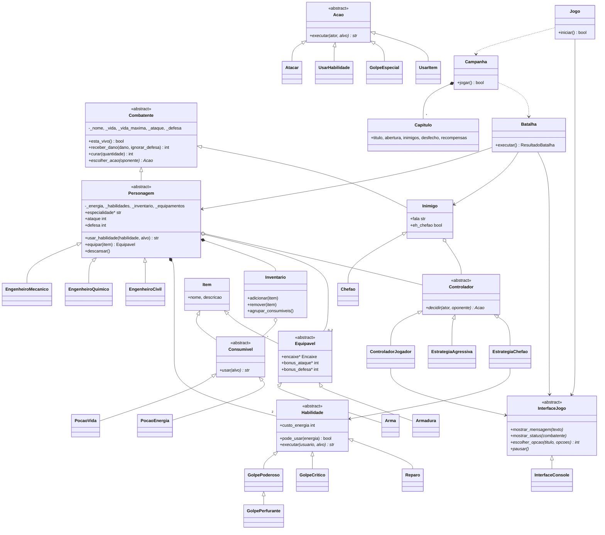
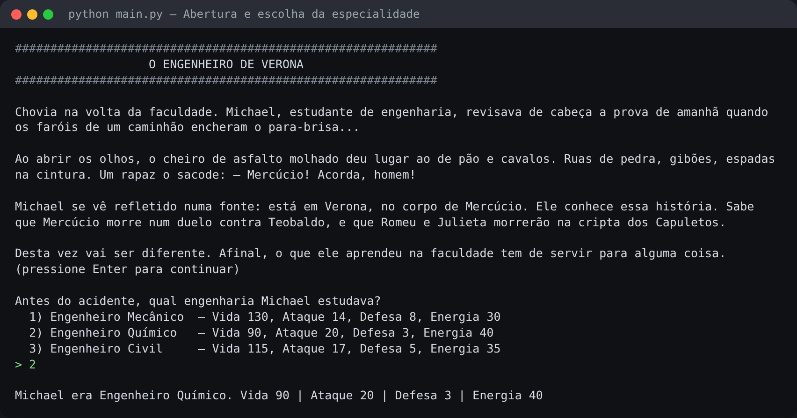
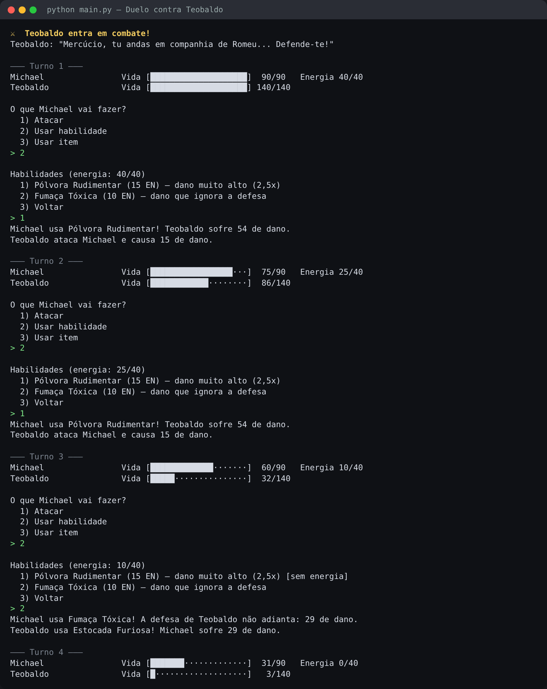
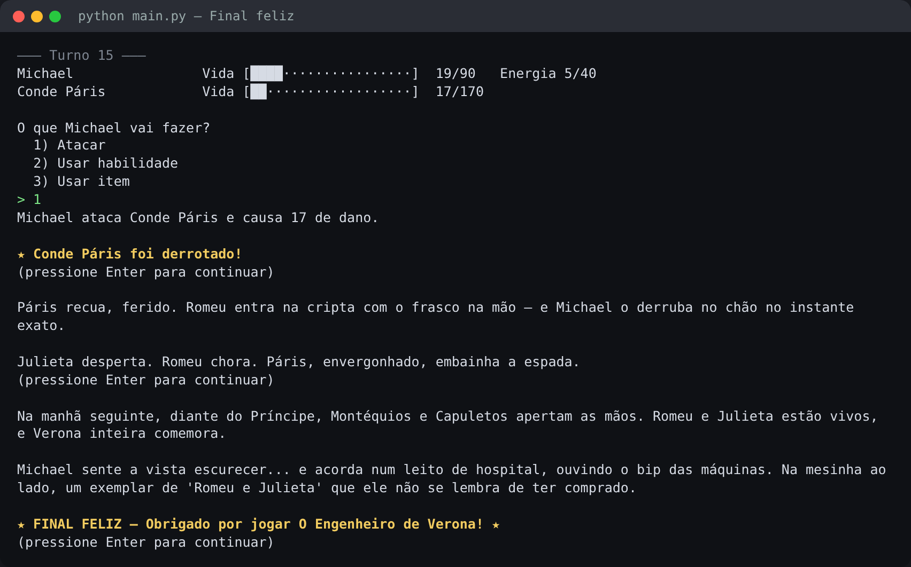

# O Engenheiro de Verona

RPG de console em Python, feito como trabalho acadêmico, que aplica os conceitos de
Orientação a Objetos (abstração, encapsulamento, herança, composição e polimorfismo)
e os cinco princípios **SOLID**.

## Sinopse

**Michael**, estudante de engenharia, sofre um acidente de carro e acorda em Verona,
no corpo de **Mercúcio**, poucos dias antes da tragédia de *Romeu e Julieta*.
Ele sabe como a história termina e usa o que aprendeu na faculdade para mudar o final.

No início do jogo, o jogador escolhe a especialidade de Michael, que funciona como a classe do RPG:

| Especialidade        | Papel     | Perfil                   |
|----------------------|-----------|--------------------------|
| Engenheiro Mecânico  | Guerreiro | Muita vida e defesa      |
| Engenheiro Químico   | Mago      | Muito ataque, pouca vida |
| Engenheiro Civil     | Arqueiro  | Equilibrado e preciso    |

O design completo (capítulos, inimigos, chefões e itens) está em [docs/historia.md](docs/historia.md).

## Andamento

- [x] Conceito e história
- [x] Arquitetura e estrutura de pastas
- [x] Abstrações base (`Combatente`, `Habilidade`, `Item`, `InterfaceJogo`)
- [x] Personagens jogáveis (três especialidades)
- [x] Itens, equipamentos e inventário
- [x] Inimigos e chefões
- [x] Sistema de combate em turnos
- [x] Interface de console
- [x] Fluxo da história (jogo jogável do início ao fim)
- [x] Testes automatizados
- [x] Diagrama de classes
- [x] Capturas de tela

## Requisitos e como executar

- **Python 3.12** ou superior
- O jogo não usa bibliotecas externas; os testes usam o `pytest`

```bash
git clone https://github.com/Mitzspace/RPG.git
cd RPG
python main.py
```

Para rodar os testes:

```bash
pip install pytest
python -m pytest
```

## Como jogar

1. Escolha a especialidade de Michael (Mecânico, Químico ou Civil).
2. Em cada turno, escolha pelo número: **Atacar**, **Usar habilidade** (gasta Energia) ou **Usar item**.
3. O dano de um ataque é `ataque - defesa` do alvo (mínimo 1). Habilidades multiplicam o dano,
   ignoram a defesa ou curam.
4. Os chefões soltam um **golpe especial a cada 3 turnos**: prepare-se curando antes.
5. Ao fim de cada capítulo, Frei Lourenço entrega itens (os equipamentos são vestidos na hora)
   e Michael descansa, recuperando vida e energia.
6. Vencendo os três capítulos, você alcança o **final feliz**. Se a vida chegar a zero: *Game Over*.

Só atacar não basta: o jogo foi balanceado (por simulação) para exigir o uso de habilidades e itens.

| Especialidade        | Vida | Ataque | Defesa | Energia | Habilidades |
|----------------------|------|--------|--------|---------|-------------|
| Engenheiro Mecânico  | 130  | 14     | 8      | 30      | Golpe de Alavanca (2x, 10 EN), Armadura Improvisada (cura 35%, 12 EN) |
| Engenheiro Químico   | 90   | 20     | 3      | 40      | Pólvora Rudimentar (2,5x, 15 EN), Fumaça Tóxica (1,2x ignorando defesa, 10 EN) |
| Engenheiro Civil     | 115  | 17     | 5      | 35      | Balestra de Precisão (50% de chance de 3x, senão 1,3x, 10 EN), Armadilha de Polia (1,5x, 8 EN) |

## Estrutura do projeto

```
RPG/
├── main.py                    # Ponto de entrada (python main.py)
├── docs/
│   ├── historia.md            # Documento de design da história
│   └── capturas/              # Capturas de tela
├── rpg/
│   ├── jogo.py                # Monta o jogo: personagem, campanha e interface
│   ├── entidades/
│   │   ├── combatente.py      # Classe abstrata Combatente
│   │   ├── personagens.py     # Personagem + as três especialidades
│   │   └── inimigos.py        # Inimigo, Chefao e catálogo de inimigos
│   ├── habilidades/
│   │   ├── habilidade.py      # Classe abstrata Habilidade
│   │   └── habilidades.py     # GolpePoderoso, GolpePerfurante, GolpeCritico, Reparo
│   ├── itens/
│   │   ├── item.py            # Item, Consumivel, Equipavel
│   │   ├── itens.py           # PocaoVida, PocaoEnergia, Arma, Armadura + catálogo
│   │   └── inventario.py      # Inventario (bolsa de consumíveis)
│   ├── combate/
│   │   ├── acoes.py           # Acao: Atacar, UsarHabilidade, GolpeEspecial, UsarItem
│   │   ├── controladores.py   # Controlador: jogador humano e estratégias dos inimigos
│   │   └── batalha.py         # Batalha em turnos
│   ├── historia/
│   │   ├── capitulo.py        # Capitulo (dados) e Campanha (fluxo)
│   │   └── roteiro.py         # Textos e capítulos da história
│   └── interface/
│       ├── interface_jogo.py  # Abstração de entrada e saída
│       └── console.py         # Implementação para o terminal
└── tests/                     # Testes automatizados (pytest)
```

## Conceitos de Orientação a Objetos

- **Abstração:** `Combatente`, `Habilidade`, `Consumivel`, `Equipavel`, `Acao`, `Controlador` e
  `InterfaceJogo` são classes abstratas que definem contratos sem implementação.
- **Encapsulamento:** atributos são protegidos (`_vida`, `_energia`...) e expostos por propriedades
  somente leitura; listas internas saem como tuplas/cópias. A vida só muda por `receber_dano()` e `curar()`.
- **Herança:** `Personagem` e `Inimigo` herdam de `Combatente`; `Chefao` herda de `Inimigo`;
  `GolpePerfurante` herda de `GolpePoderoso`.
- **Composição:** `Personagem` TEM habilidades, inventário, equipamentos e um controlador;
  `Inimigo` TEM uma estratégia; `Campanha` TEM capítulos.
- **Polimorfismo:** a `Batalha` chama `ator.escolher_acao()` e `acao.executar()` sem saber se o ator é
  jogador ou inimigo, nem qual ação foi escolhida. `Personagem` sobrescreve `ataque` e `defesa` para
  somar os equipamentos, e `Combatente.receber_dano()` passa a considerar a armadura automaticamente.

## Princípios SOLID

### S — Responsabilidade Única
Cada classe tem um único papel. `Combatente` cuida apenas das regras de vida e dano
e **não exibe nada na tela**: métodos como `receber_dano()` devolvem valores, e quem
mostra as mensagens é a interface. `Habilidade` só descreve o efeito e não gasta energia
(quem controla a energia é o `Personagem`). A `Batalha` só organiza a ordem dos turnos,
o `Inventario` só guarda itens, `Capitulo` só guarda dados e o `roteiro.py` só guarda textos.

### O — Aberto/Fechado
`Habilidade`, `Item`, `Acao` e `Controlador` são extensíveis por subclasses. Uma habilidade,
item, ação ou estratégia de inimigo nova é uma subclasse nova, **sem alterar código existente**.
Uma especialidade nova é uma subclasse de `Personagem` adicionada à lista `ESPECIALIDADES`;
um capítulo novo é mais um `Capitulo` no roteiro.

### L — Substituição de Liskov
Habilidades, itens e ações recebem `Combatente` (a abstração). Qualquer subclasse ocupa esse
lugar sem quebrar nada: por exemplo, o `Elixir` usado em quem não tem energia simplesmente não
faz efeito, em vez de lançar erro. Nos testes, um `Personagem` criado só para o teste joga a
campanha inteira sem que a `Campanha` perceba a diferença.

### I — Segregação de Interfaces
Os itens são divididos em duas interfaces pequenas: `Consumivel`, com `usar()`, e
`Equipavel`, com encaixe e bônus de ataque e defesa. Uma espada não é obrigada a implementar
`usar()`, e uma poção não é obrigada a ter bônus de ataque.

### D — Inversão de Dependência
O jogo conversa com o jogador apenas pela abstração `InterfaceJogo`, nunca diretamente
por `print()`/`input()` — só `InterfaceConsole` usa essas funções. Os personagens dependem da
abstração `Controlador`, e o `GolpeCritico` recebe o gerador de números aleatórios no construtor.
Por isso os testes trocam a interface por uma `InterfaceFalsa` e o acaso por um valor fixo.

## Diagrama de classes



## Capturas de tela

**Abertura e escolha da especialidade**



**Duelo contra Teobaldo** (repare no golpe especial do chefão no 3º turno)



**Final feliz**


